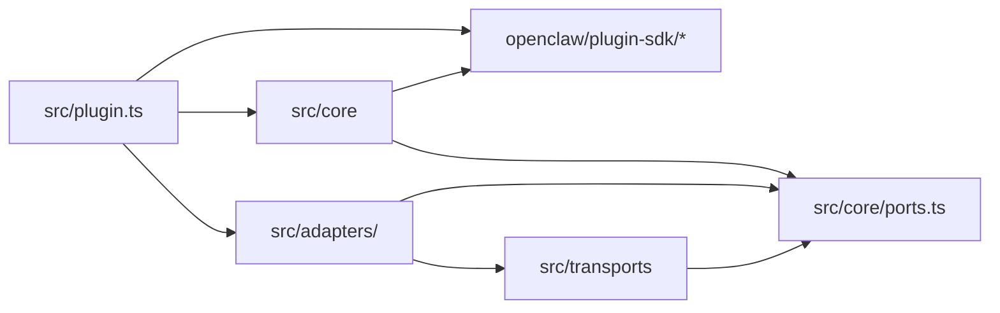
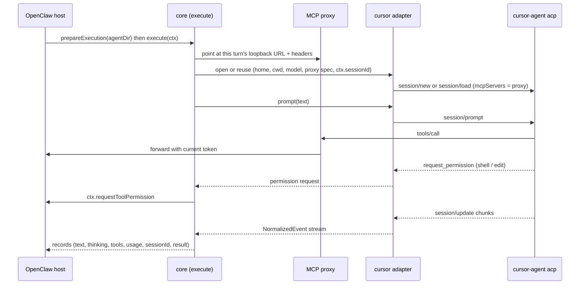

# Architecture Spine — openclaw-all-cli

## Design Paradigm

Hexagonal. **OpenClaw is the host** and already owns session binding, per-session queues, live-session handles, timeouts, the tool-availability contract, and the per-run MCP grant; the plugin uses those, never duplicates them. The **core** owns what the host leaves to a backend: the execute seam, event normalization, per-agent CLI homes, the MCP proxy, tool-permission routing, the live-process reuse check, and operations. An **adapter** knows one CLI. A **transport** is a reusable way to talk to a process (ACP session, JSONL spawn per turn).

| Layer | Directory | May import |
| --- | --- | --- |
| Composition root | `src/plugin.ts` | `openclaw/plugin-sdk/*`, core, adapters |
| Core | `src/core/` | `openclaw/plugin-sdk/*`, core ports |
| Transports | `src/transports/` | Core ports, protocol libraries (ACP, MCP) |
| Adapters | `src/adapters/<cli>/` | Core ports, transports |

## Invariants & Rules



### AD-1 — One plugin, one standalone backend per CLI

- **Binds:** CAP-1, CAP-12
- **Prevents:** a separate plugin per CLI that duplicates the core; backend IDs that drift from model refs; backends hidden from model pickers.
- **Rule:** The package `openclaw-all-cli` is one OpenClaw plugin. It registers one CLI backend per adapter through `api.registerCliBackend`, with ID `<cli>-cli` (`cursor-cli`, `antigravity-cli`). That ID is listed in the manifest `cliBackends` and `setup.cliBackends`, and model refs are `<cli>-cli/<model>`. Backends do not set `modelProvider`. A CLI login counts as auth through OpenClaw's synthetic-auth path (`syntheticAuthRefs`, a provider catalog entry with `prepareSyntheticAuth`).

### AD-2 — Dependency direction

- **Binds:** all
- **Prevents:** CLI-specific logic leaking into the core; adapters reaching into OpenClaw; adapters depending on each other.
- **Rule:** Follow the diagram above. Only `src/plugin.ts` and `src/core/` import `openclaw/plugin-sdk/*`. Adapters import only `src/core/ports.ts` and `src/transports/`. No adapter imports another adapter. The core never imports an adapter or names a CLI.

### AD-3 — One execution seam and one event language

- **Binds:** CAP-2, CAP-3, CAP-6, CAP-11
- **Prevents:** each adapter writing its own `parseJsonlEvent` with diverging semantics.
- **Rule:** Every backend runs turns through the custom `execute` returned by `prepareExecution`, the seam `claude-cli` uses. Adapters map native output to the core `NormalizedEvent` union in `src/core/ports.ts`: `text`, `thinking`, `toolStart`, `toolResult`, `usage`, `sessionId`, `result`, `error`. Each variant's meaning is defined there once:
  - `text` and `thinking` are deltas.
  - `usage` is per turn.
  - `sessionId` is the native ID to resume.
  - `result` closes the turn exactly once.
  - Native tool events are display-only.

  The core alone yields records to OpenClaw and implements `parseJsonlEvent`.

### AD-4 — Cursor runs over an ACP session

- **Binds:** CAP-2, CAP-4, CAP-6, CAP-7, CAP-11
- **Prevents:** a per-turn `-p` design with no host approvals or warm session that needs files in the user's repo; a Cursor-only ACP client Antigravity can't reuse.
- **Rule:**
  - **Transport.** The Cursor adapter speaks ACP to `cursor-agent acp`, through the generic client in `src/transports/acp/`, which contains no Cursor-specific code.
  - **Secondary transport.** `cursor-agent -p --output-format stream-json` is allowed only behind the same adapter, as a usage source, and must never resume the live session's chat.
  - **Not OpenClaw's ACP Agents.** The built-in `cursor` harness of OpenClaw ACP Agents is not used, because it gives spawned ACP sessions, not `/model` provider refs.

### AD-5 — OpenClaw owns session binding

- **Binds:** CAP-4, CAP-5, CAP-9
- **Prevents:** a second owner of the session-to-chat mapping that ignores `/reset`, auth-epoch changes, and fresh-session recovery.
- **Rule:** The native session ID to resume is `ctx.sessionId` when `ctx.useResume` is true; otherwise a new native session starts. New IDs flow back only as `sessionId` events. The plugin keeps no session map. Data that must outlive a process goes only in `api.runtime.state.openKeyedStore({ retention: "retained" })`, keyed by the native session ID.

### AD-6 — Per-agent CLI home

- **Binds:** CAP-8, CAP-9
- **Prevents:** agents sharing CLI config, chat stores, or permission files; adapters choosing their own state paths; parallel sessions racing on a policy file.
- **Rule:**
  - **Location.** The core derives the home from `prepareExecution` `agentDir` as `<agentDir>/openclaw-all-cli/<backendId>/` and passes it to the adapter. The adapter maps it to the CLI's own variables (Cursor: `CURSOR_CONFIG_DIR`, `CURSOR_DATA_DIR`).
  - **Contents.** The home holds only static permissions (AD-9), written once with atomic rename. Per-turn policy never goes into a file.
  - **Working directory and login.** The working directory is OpenClaw's (`ctx.cwd`), and the CLI login stays shared.

### AD-7 — Never write into the user's workspace

- **Binds:** CAP-6, CAP-7, CAP-8
- **Prevents:** `.cursor/mcp.json` or `cli.json` landing in the user's repository.
- **Rule:** CLI configuration goes only into the per-agent home (AD-6) or into session parameters such as ACP `session/new.mcpServers`. The plugin creates or changes no file in the agent's working directory.

### AD-8 — The host owns per-session queueing

- **Binds:** CAP-9
- **Prevents:** OpenClaw's single global lane for third-party backends; two turns of one session at once; a second, plugin-made lane system.
- **Rule:** Backends declare `liveSession: "claude-stdio"`, `input: "stdin"`, and `output: "jsonl"`, so the host queues per session owner and hands `ctx.liveSession` to `execute`. The core adds only a per-backend cap on concurrent turns and on live processes. If the host rejects `liveSession` for a third-party backend, the fallback is `serialize: false` plus a core lane keyed by the hash of `{agentDir, ctx.sessionId}`; that fallback needs an amended AD-8 before it is built.

### AD-9 — Tool policy follows claude-cli

- **Binds:** CAP-6, CAP-7, CAP-11
- **Prevents:** OpenClaw tools reaching the model by different paths per adapter; a native shell or writer running on the host; adapters re-implementing tool filtering.
- **Rule:**
  - **OpenClaw tools.** They reach the model only through the MCP proxy (AD-12). Backends set `bundleMcp: true`, `bundleMcpMode: "gemini-system-settings"`, `nativeToolMode: "selectable"`, `toolAvailabilityEnforcement: "execution-args"` with a `resolveExecutionArgs` (as `claude-cli` does), and `hostOwnedTools: ["exec", "process"]`. `resolveExecutionArgs` returns the host's `baseArgs` (plus a marker that `execute` strips, when the host serves `exec` for the run), or nothing (the host then fails the run) when the turn's native selection drops a tool the adapter cannot switch off. `prepareExecution` refuses the same selection early, with a message. The host serves `exec` and `process` to the model only this way, over its own loopback, so they run under OpenClaw's approvals, sandbox, timeout, and output limits, and the plugin runs and parses no command. The host's contract is that the adapter has disabled the equivalent native tools; the static `Shell(*)` deny keeps it. The adapter uses Cursor's `agent` mode only when the host serves `exec` for the run (the model refuses file-changing commands in `ask` mode) and `ask` mode otherwise. Cursor cannot switch off its native read, grep, and glob per run, so those stay open (below). The host filters the OpenClaw tool list, and adapters never translate `tools.allow`/`deny`.
  - **Per-agent permissions.** These are the same for every agent:
    - deny native shell, write, edit, and delete, which Cursor then blocks without asking (checked live in `agent` mode). A `WebFetch(*)` deny is written too but has no effect in Cursor: a native web fetch asks the host in either mode, and OpenClaw's tool policy decides;
    - allow the proxy's MCP server;
    - allow native read, grep, and glob, as `claude-cli` keeps its native readers.
  - **Permission requests.** A CLI permission request goes to `ctx.requestToolPermission`. If the CLI can't ask, the tool stays denied.
  - **Risk: credentials are readable by `exec`.** The host serves `exec` as the Gateway's user, so a model command can read `~/.config/cursor/auth.json` (the login's tokens, and the key whenever `cursor-agent` ran with one), the OpenClaw config holding `cursor-cli.env` and its rotated backups, and the `cursor-agent` process environment. The login is no safer than a key; exec approvals and a sandbox are the protection.

### AD-10 — A capability manifest per adapter

- **Binds:** CAP-10, CAP-11, CAP-12
- **Prevents:** backend flags set ad hoc per adapter; the parity matrix and the code drifting apart.
- **Rule:** Each adapter exports a static manifest keyed by the parity rows P1–P19 of `claude-cli-parity.md`, each marked `match`, `approx`, or `gap`. The core derives backend flags only from it. Each backend mechanism has one parity row (`FLAG_ROWS`); rows that set no flag are listed with a reason (`NO_FLAG_ROWS`). Manifest rows may declare the runtime capabilities they `requires`; the transport maps what the CLI reports (ACP `agentCapabilities`) onto neutral names, and the core checks, right after the adapter's open, the capabilities the session reports, for decided rows only. A mismatch fails the turn with `CliError` code `capability_mismatch` before any prompt. The version stays a separate check (AD-14). A manifest change updates the matrix, `docs/providers/<cli>.md`, and that row's live test in the same change.

### AD-11 — The host owns timers, the core owns process shutdown

- **Binds:** CAP-2, CAP-4, CAP-9
- **Prevents:** two watchdogs killing one process; a process killed while a human approves; retries after a tool already ran.
- **Rule:**
  - **Interface.** Adapters implement `open`, `prompt`, `cancel`, and `close` from `src/core/ports.ts`.
  - **Timers.** The host owns timing: the core honors `ctx.timeoutMs`, `ctx.abortSignal`, and the backend's `reliability.watchdog`, and starts no timer of its own.
  - **Abort.** On abort, the core answers every pending CLI permission request with `cancelled`, calls `cancel`, then `close` after a 5-second grace.
  - **Errors.** Adapters throw only `CliError { code, retryable, message }`. `code` is a closed union mapped one-to-one onto OpenClaw's `FailoverReason`. `retryable` is false once any tool call started in the turn.
  - **Errors reported as reply text.** A CLI that reports a failed turn as its last reply chunk plus a normal stop (Cursor does) gets a hook on the transport, `classifyReplyError(text)`. The transport holds a recognised chunk; anything after it flushes it as ordinary text, a normal stop right after it makes the turn that `error` (no `result`, retryable only if the hook says so and no tool started), and a cancel drops it. Only the adapter knows the wording, and its messages carry the keywords the host reads, since the host classifies by message text alone.

### AD-12 — A stable MCP proxy per live session

- **Binds:** CAP-6, CAP-9, CAP-11
- **Prevents:** a warm session calling OpenClaw with turn 1's revoked token, wrong capture key, or wrong tool policy; a Gateway restart silently stranding tools.
- **Rule:**
  - **Proxy.** The core runs one local HTTP MCP endpoint per live session, on `127.0.0.1` with a random port and its own random Bearer token. This is the only MCP server given to the CLI.
  - **Each turn.** The core reads the current loopback URL and headers (`Authorization`, `x-openclaw-cli-capture-key`) from `GEMINI_CLI_SYSTEM_SETTINGS_PATH` in the execute context's env, and the proxy forwards to them.
  - **Outside a turn.** Calls are rejected.
  - **Call deadline.** A forwarded `tools/call` gets a deadline just under the CLI's own MCP timeout (55 s for Cursor's 60 s, which never hangs up). At the deadline the proxy aborts the upstream request, so the host stops the work, and answers with a tool error that tells the model to use the background. The proxy still reads no tool name or argument. This is the one timer the plugin starts (AD-11's no-timer rule covers approvals and turns).

### AD-13 — When a live process is reused

- **Binds:** CAP-4, CAP-8, CAP-9
- **Prevents:** a warm process carrying another turn's model, mode, working directory, home, or auth into this one.
- **Rule:** A live process is reused only when `modelId`, mode, `cwd`, home, `authProfileId`, and the native session ID all match the turn. Otherwise the core closes it and opens a new one, resuming via ACP `session/load` when `ctx.useResume` is true. Live processes register through `ctx.liveSession`.

### AD-14 — Operations

- **Binds:** CAP-9, CAP-10, CAP-12
- **Prevents:** orphaned CLI processes holding a chat after a crash; silent breakage on unsupported versions; unbounded warm processes.
- **Rule:**
  - **Version check.** On the first turn per backend, the adapter checks the CLI version against its manifest floor (Cursor ≥ 2026.07.06) and the ACP `protocolVersion` (1). A miss fails with `CliError` `unsupported_version`.
  - **Orphans.** Each home holds a pid lock file; on startup the core kills stale owners recorded there.
  - **Idle processes.** Live processes close after 15 idle minutes.
  - **Unload.** Plugin unload closes all live processes.
  - **Exception.** The throwaway process of a model listing has no pid lock and is not closed on unload; it lives for a few seconds.
  - **Platforms.** macOS and Linux are supported.

### AD-15 — The host's system prompt reaches the CLI as a prompt block

- **Binds:** CAP-6, CAP-11
- **Prevents:** a CLI that never sees OpenClaw's instructions or skills; a chat thrown away whenever the tool list changes; instruction files written into a workspace or home.
- **Rule:** The host's system prompt, with its skills catalog, reaches a CLI that has no per-turn system-prompt channel as a marked block at the start of the prompt. It is sent on a native chat's first prompt and again when it changes (the date and the runtime line's model, channel, capabilities, and active-node fields do not count; a change of only those sends a one-line runtime update with the current values). The core keeps a delivery cache of hashes keyed by (home, native session id), in memory over a small file in the agent home; like AD-5's binding rule it is a cache, not a session binding: losing it costs one duplicate block. The core neutralizes the block's header, update opener, and tag name (any spelling, original case kept, one zero-width space added) in the text it forwards; text that reaches the CLI by other routes (tool output, the CLI's own reads) is not covered. When P12 is decided (AD-10), the backend declares `systemPromptWhen: "always"` with a marker arg the host never passes to a plugin-owned execute. No instruction or skill file is written into a workspace or user home (AD-6, AD-7); the only file is the hash cache in the plugin's own agent home.

### AD-16 — Images reach a CLI as image blocks; compaction stays the host's

- **Binds:** CAP-11
- **Prevents:** a CLI that gets only a file path it must open itself; image files the plugin writes, copies, or must clean up; a prompt parser that reads any file a user names; a plugin that declares native compaction it cannot drive and so switches off the host's.
- **Rule:** Images reach a CLI as its protocol's image blocks. The core reads them from the host's own image cache (the trailing path block OpenClaw appends to the prompt for a backend without `imageArg`). It checks the directory, owner, type by magic bytes, and size, and drops the paths from the text. The plugin writes, copies, and deletes no image file (AD-6, AD-7). An image it cannot pass becomes a one-line note, never a silent drop. A CLI without native compaction leaves compaction to the host's transcript compaction; P14 sets no flag.
  - **Block membership** (path shape, then freshness): the trailing run of lines must follow an empty line or be the whole prompt, be at most the image limit plus a small margin, and every line must be a normalized absolute path `<tmp>/openclaw[-<uid>]/openclaw-cli-images/<64 hex>.<ext>`, where `<tmp>` resolves to `/tmp` or `os.tmpdir()` and `<uid>` is exactly the process uid. Every file must have been written within 15 minutes before the turn began (the host writes them when it prepares the turn, before its own queue wait, which is the only legitimate delay), so a path a user typed for an older cache file stays text; an old file the process owns in the host's private directory gets a one-line too-old note instead of silence. One failing line leaves the prompt unchanged and reads nothing.
  - **Delivery** (per image): a regular file, not a link, one hard link, owned by the process uid, in a directory the uid owns that group and others cannot write, at most 10 MiB (10 images and 20 MiB in all; an image that does not fit the remaining total is skipped), and png, jpeg, gif, webp, or bmp by its first bytes. The file is opened with `O_NOFOLLOW` and `O_NONBLOCK` and checked again on the descriptor. Without a process uid (Windows) the prompt is left as it is.
  - **Logs.** No base64, image bytes, or cache path reaches a log, a note, or an error.
  - **Compaction.** The backend declares neither `ownsNativeCompaction` nor `manualCompaction`: the first would switch off the host's compaction, the only one that works; the second needs a summary prompt the CLI does not honor. A host compaction drops the CLI chat binding, and the next turn starts a fresh chat (AD-15 block, P15 note).

## Consistency Conventions

| Concern | Convention |
| --- | --- |
| Naming | Backend ID `<cli>-cli`; adapter dir `src/adapters/<cli>/`; files kebab-case; types PascalCase |
| Language and module | TypeScript strict, ESM, Node built-ins via `node:` prefix |
| Config | `plugins.entries.openclaw-all-cli.config.<backendId>`, schema in `openclaw.plugin.json` (zod) |
| Logging | OpenClaw runtime logger only; never log tokens, auth headers, or prompt text |
| Secrets | Tokens and keys live in memory, in per-agent home files with mode `0600`, in `cursor-agent`'s own `~/.config/cursor/auth.json` (login tokens and any key it ran with, outside our control), and in `openclaw.json` with its rotated backups when `cursor-cli.env` holds a key |
| Tests | Unit tests next to code (`*.test.ts`, vitest); live tests in `test/live/`, run only with `OPENCLAW_ALL_CLI_LIVE=1`, one per parity row |
| Docs | `docs/setup.md` plus `docs/providers/<cli>.md`, updated in the same change as setup, config, or behavior |
| Language | English in code, docs, commits, and names |

## Stack

| Name | Version |
| --- | --- |
| Node.js | ≥ 24.16 < 25, or ≥ 26.1 (OpenClaw engines) |
| OpenClaw (peer) | ≥ 2026.10.3 |
| TypeScript | 7.0.2 |
| @types/node | 24.19.2 |
| vitest | 5.0.5 |
| zod | 4.6.7 |
| @agentclientprotocol/sdk | 1.8.0 |
| @modelcontextprotocol/sdk | 1.32.1 |
| cursor-agent | ≥ 2026.07.06; tested 2026.10.14-941492e |

## Structural Seed

```text
openclaw-all-cli/
  openclaw.plugin.json     # id, cliBackends, setup.cliBackends, syntheticAuthRefs, configSchema
  package.json             # openclaw.extensions / runtimeExtensions, peer openclaw
  src/
    plugin.ts              # composition root: definePluginEntry, one backend per adapter
    core/                  # ports, backend builder, events, homes, mcp proxy, permissions, reuse, operations
    transports/
      acp/                 # generic ACP client session
      jsonl/               # spawn-per-turn JSONL process
    adapters/
      cursor/              # cursor-agent: manifest, ACP mapping, permissions, models
  test/live/               # gated live tests per parity row
  docs/                    # setup.md, providers/<cli>.md
```



**Environments.** Development and live tests run against an isolated OpenClaw (`OPENCLAW_STATE_DIR`, `OPENCLAW_CONFIG_PATH`) on a supported Node. Users install with `openclaw plugins install <path or package>`; the plugin runs inside their Gateway process and spawns CLIs on the same host.

## Capability → Architecture Map

| Capability / Area | Lives in | Governed by |
| --- | --- | --- |
| CAP-1 model selection, auth | `src/plugin.ts`, `src/adapters/cursor/` | AD-1, AD-10 |
| CAP-2 streaming | `src/core/` events, `src/transports/acp/` | AD-3, AD-4, AD-11 |
| CAP-3 usage | adapter `usage` event, or the optional `readUsage` port (core `readTurnUsage`) that fills the result record after a turn; Cursor reads its usage ledger | AD-3, AD-4. The Cursor adapter keeps an in-memory per-session map (bounded to 1000 sessions) of consumed ledger stamps and read end times for usage matching; it is lost on a Gateway restart, which can reopen the overlap case for the first turn after a restart. |
| CAP-4 resume | host binding, adapter `open` | AD-5, AD-13 |
| CAP-5 portability | OpenClaw reseed and `sessions_history` tool | AD-5 |
| CAP-6 OpenClaw tools | `src/core/` MCP proxy, `src/core/system-prompt.ts` | AD-9, AD-12, AD-15 |
| CAP-7 native tools locked down | `src/core/` permissions, adapter | AD-7, AD-9 |
| CAP-8 isolation | `src/core/` homes | AD-6, AD-7, AD-13 |
| CAP-9 concurrency | host lanes, `src/core/` caps and operations | AD-8, AD-11, AD-14 |
| CAP-10 setup docs | `docs/` | AD-10, conventions |
| CAP-11 claude-cli parity | adapter manifests, `src/core/images.ts`, `test/live/` | AD-3, AD-9, AD-10, AD-15, AD-16 |
| CAP-12 new CLI as adapter | `src/adapters/<cli>/`, `src/transports/` | AD-1, AD-2, AD-4, AD-10 |

## Open Questions

| Question | Blocks |
| --- | --- |
| Does the host accept `liveSession: "claude-stdio"` from a third-party `execute` backend? Answered yes by epic entry 1 (OpenClaw 2026.10.3 accepts it from this plugin), so AD-8 stands unamended and its fallback lane is not built. | AD-8, first backend story |
| Does a third-party plugin's synthetic auth (`nonSecretAuthMarkers`) count as auth? | CAP-1 |
| Where does Cursor ACP usage come from? Answered by the spike: no exact source on ACP; input side is estimable from the session store (about 2%), output is not; hooks did not fire here. Shipping without usage is a last resort (user). Answered after entry 9: Cursor's server usage ledger (exact, needs `CURSOR_API_KEY`), read through the optional `readUsage` port; see the spike addendum and entry 10. | CAP-3, epic entry 9 |
| Does the Gemini-mode settings file always carry the loopback URL and headers in `execute` env? | AD-12, CAP-6 |
| Is a Cursor API key billed against the subscription (spec Q3)? | CAP-5 reseed setup |
| Can two Cursor processes resume one chat safely (spec Q4)? Answered by a live probe (2026-10-18, cursor-agent 2026.10.16): no. Both load the chat without an error, but each keeps its own view and a turn in one is invisible to the other; the stored chat keeps one process's turns. The core therefore allows one process per chat (it closes an idle holder, refuses while one is mid-turn). | AD-13 |
| Is OpenClaw #148584 (plugin skipped at Gateway startup) fixed? | CAP-1 |
| Does Cursor ACP honor images, compaction? Images: yes, ACP `image` blocks work (ticket 1.14, AD-16). Compaction: no control over ACP, so P14 is a gap and OpenClaw's own transcript compaction applies (ticket 1.14). Skills and a system prompt: answered by ticket 1.13 (no: `acp` ignores `--plugin-dir` and has no system-prompt channel; the skills catalog and system prompt reach Cursor as a prompt block, AD-15). | Parity rows P13, P14 |

## Deferred

- **Approval for native edits.** Cursor ACP edits don't ask, so AD-9 denies them. Revisit if Cursor adds an asking mode.
- **`@cursor/sdk` transport.** Not used. Revisit if ACP blocks a parity row the SDK covers.
- **Antigravity adapter.** Its transport, flags, and manifest wait for research. AD-1, AD-2, AD-4, and AD-10 fix how it plugs in.
- **Distribution.** npm package versus ClawHub, and release automation; not in this initiative (user decision, 2026-10-16).
- **Observability beyond logs.** Metrics or traces, if the host exposes a channel for them.
- **Windows support.** Not in stage 1.
